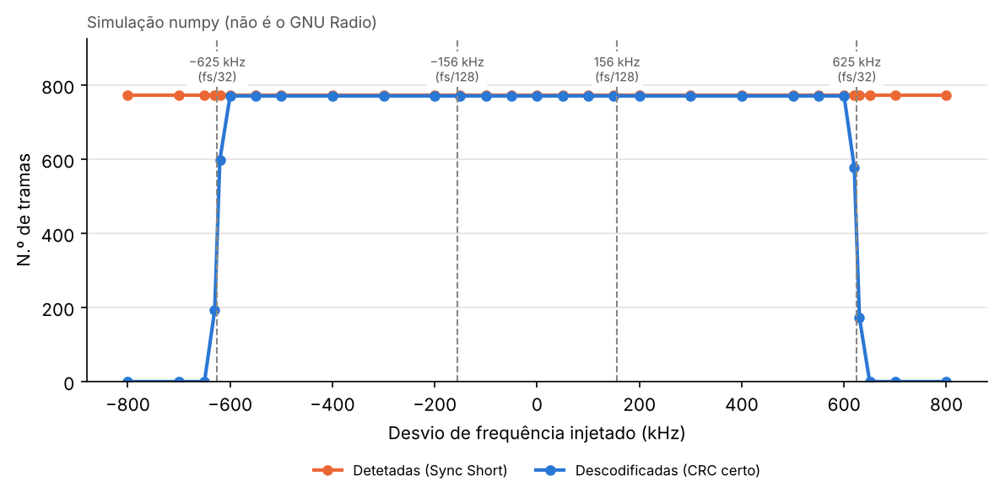
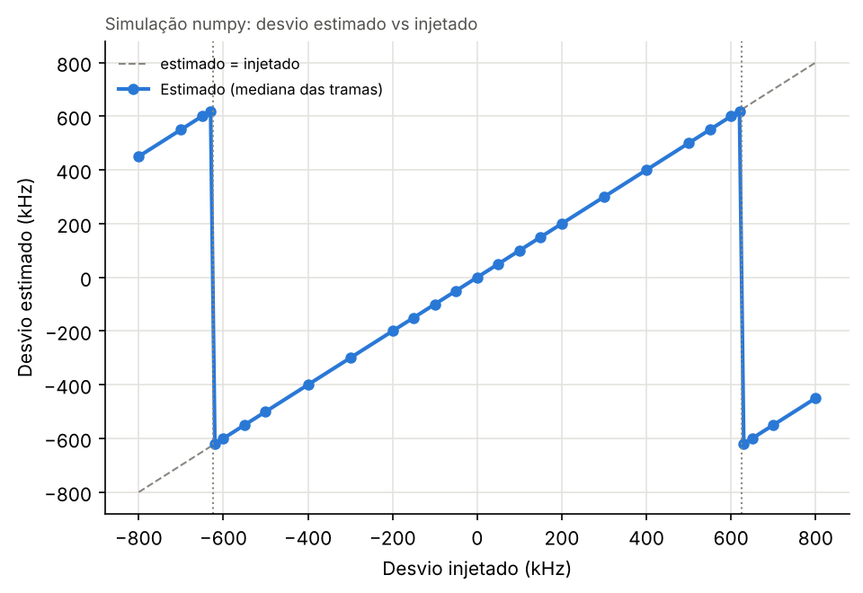
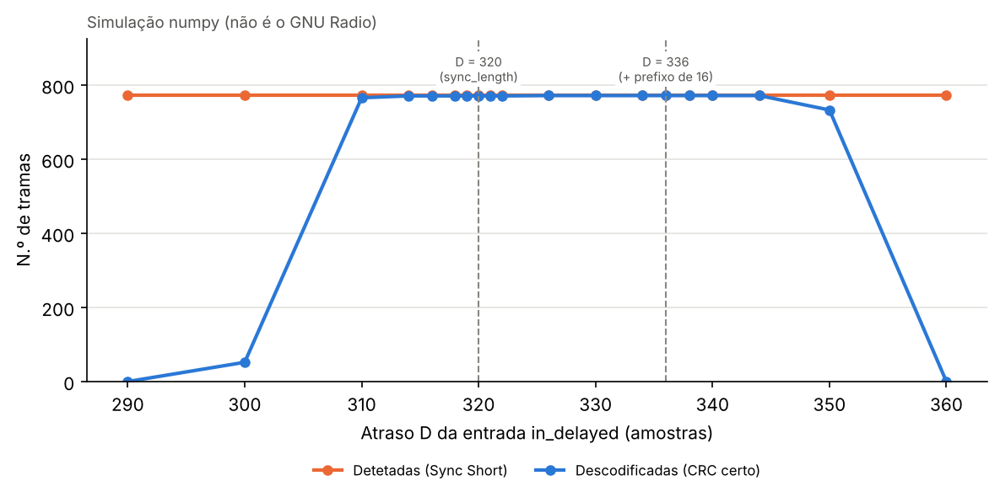
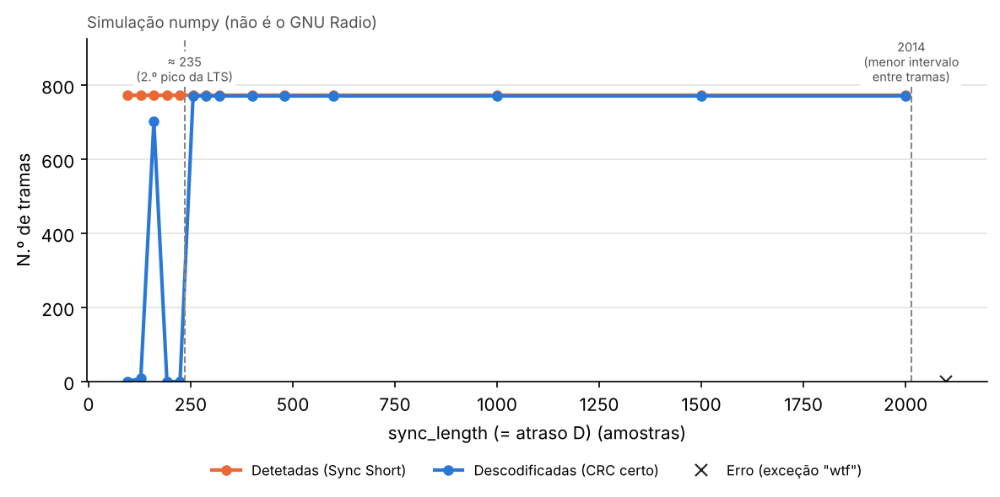
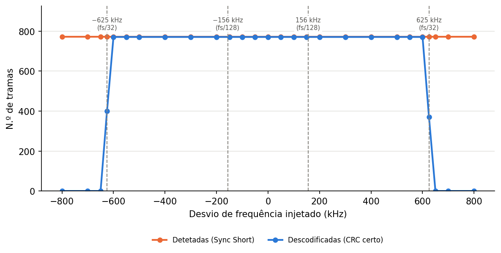
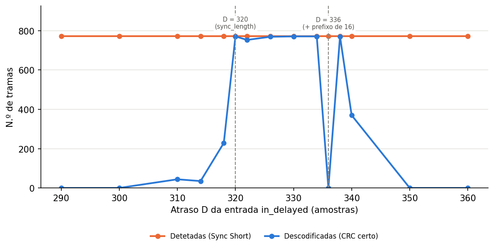
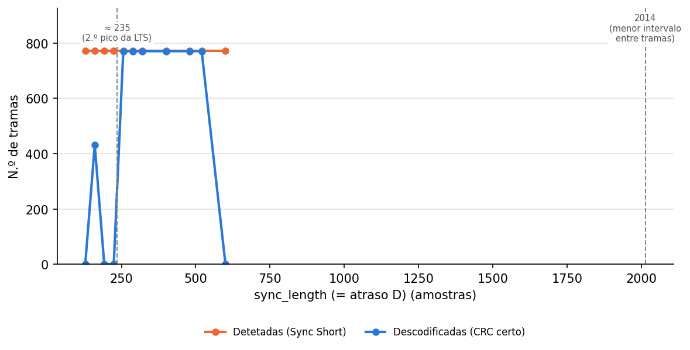

# Week 03 — OFDM Sync Long e correção do desvio de frequência

Código analisado: `gr-ieee802-11/lib/sync_long.cc` (ramo `maint-3.10`). Os números de linha referem-se a esse ficheiro.
Parâmetros do sistema: fs = 20 MHz, sequência curta (STS) com período 16, sequência longa (LTS) com 2 × 64 amostras precedidas de um prefixo de 32.

---

## 1. O que faz o bloco OFDM Sync Long

O bloco tem **duas entradas** (linha 43): `in` (saída do Sync Short) e `in_delayed` (a mesma saída, atrasada por um bloco Delay no fluxograma). Funciona como uma máquina de três estados (linha 233):

| Estado | Linhas | O que faz |
|---|---|---|
| **SYNC** | 102–124 | Passa as primeiras `SYNC_LENGTH` (= 320) amostras da trama por um filtro adaptado à LTS (`d_fir`, linha 103) e guarda cada valor de correlação com a sua posição (linha 108). Ao chegar a 320 amostras chama `search_frame_start()` (linha 114). |
| **COPY** | 126–148 | Copia a trama a partir de `in_delayed`, corrige o desvio de frequência fino (linha 140) e **remove o prefixo cíclico** de cada símbolo (linha 139): mantém as 128 amostras da LTS e, de cada símbolo de 80 amostras seguinte, só as últimas 64. A saída são símbolos de 64 amostras prontos para a FFT. |
| **RESET** | 150–163 | Quando chega a tag de uma nova trama (linhas 89–90), escreve zeros até a saída estar alinhada a um múltiplo de 64 (linha 152) e volta a SYNC. Serve para o Stream to Vector seguinte nunca ficar desalinhado. |

**Filtro adaptado.** Os 64 coeficientes `LONG` (linhas 257–290) são a LTS **conjugada e invertida no tempo**: `LONG[k] = conj(L[63−k])` (por exemplo, `LONG[63] = 1.3868` ↔ `L[0]`, `LONG[62] = conj(L[1])`). A saída do filtro na posição *p* é a correlação Σ conj(L[m])·s[p+m], que tem um pico quando *p* é o início de um símbolo LTS.

**`search_frame_start()` (linhas 189–230).**
1. Ordena as 320 correlações por módulo (linha 194).
2. Entre os 4 maiores picos, procura um par separado de **64 amostras** (as duas cópias da LTS) (linhas 203–215).
3. Início da trama = o pico mais cedo (linha 216).
4. Desvio fino = `arg(first · conj(second)) / 64` (linha 217).
5. Tolera pares a 63 ou 65 amostras (linhas 221–227). Se não encontrar nenhum par, usa `d_frame_start = SYNC_LENGTH` (linha 201), o que dá uma trama mal cortada.

---

## 2. Onde é implementada a correção do desvio de frequência?

Um desvio Δf entre emissor e recetor roda cada amostra de ω = 2π·Δf/fs rad. Duas amostras que deviam ser iguais, separadas por um período *L*, diferem só pela rotação ω·L. O ângulo do produto, dividido por *L*, estima ω.

Nesta versão a correção é feita **em duas etapas, em dois blocos**:

| Etapa | Bloco | Sequência usada | Estimativa | Gama sem ambiguidade |
|---|---|---|---|---|
| Grosseira | Sync Short (linhas 81, 108, 119 do `sync_short.cc`) | STS, período 16 | ω̂₁ = arg(a[n]) / 16 | \|Δf\| < fs/32 = **625 kHz** |
| Fina | Sync Long (linha 217, aplicada na linha 140) | LTS, período 64 | ω̂₂ = arg(pico₁ · pico₂*) / 64 | \|Δf\| < fs/128 = **156,25 kHz** |

- **Compromisso:** um período maior dá mais precisão (o ruído pesa menos no ângulo), mas uma gama menor. A etapa curta remove o desvio grande e a longa estima o **resíduo** que sobra.
- **Sinal:** com o primeiro pico em *p* e o segundo em *p+64*, `first · conj(second)` tem ângulo −64ω. Por isso `d_freq_offset` = −ω, e a linha 140 multiplica por exp(+j·n·d_freq_offset) = exp(−jωn), anulando a rotação.
- **Passagem da estimativa entre blocos:** o Sync Short manda a sua estimativa no valor da tag `wifi_start`, que o Sync Long lê na linha 92 (`d_freq_offset_short`). O Sync Long volta a emitir a tag com o **desvio total** `d_freq_offset_short − d_freq_offset` (linha 135) para os blocos seguintes. *(A confirmar na semana 5/6: o Frame Equalizer deve usar este valor.)*
- Conversão para Hz: Δf = ω · fs / (2π).

---

## 3. Que parâmetros se podem variar?

| Parâmetro | Onde | Efeito esperado |
|---|---|---|
| Desvio de frequência injetado `freq_offset` | Fluxograma: *Signal Source* × *Multiply* à entrada | Experiência principal (ver secção 5). |
| `sync_length` | Parâmetro do bloco (linhas 41, 50) | Janela onde se procuram os picos da LTS. Se for curta demais, o 2.º pico fica fora da janela e a trama perde-se (nesta gravação, abaixo de ≈ 235). Se for longa demais, **o fim de cada trama perde-se**: a cópia pára quando a tag da trama seguinte chega à entrada sem atraso (linhas 83–90), e nessa altura a entrada atrasada ainda vai `sync_length` amostras atrás. No GNU Radio, com esta gravação, as perdas começam entre 530 e 560. Muito mais acima, a exceção `"wtf"` (linhas 86–87) aparece quando `sync_length` passa o intervalo entre deteções. Ver 5.3 e 5.4. |
| Atraso da entrada `in_delayed` | Fluxograma: bloco Delay | Tem de ser igual a `sync_length` (ver secção 4). |
| Tolerância 63/65 e n.º de picos (4) | Código, linhas 203–227 | Só se recompilarmos. Mais tolerância ajuda com ruído, mas aceita mais pares errados. |
| Correção grosseira ligada/desligada | Código do Sync Short | Desligando-a, a gama total desce de ≈ 625 kHz para ≈ 156 kHz. Mostra para que serve cada etapa. |
| Ruído (σ do Noise Source) | Fluxograma | Repetir o varrimento de frequência com ruído. |

---

## 4. Porque existe uma entrada atrasada? O que acontece se mudarmos o atraso?

**Porquê.** Na fase SYNC o bloco consome as 320 primeiras amostras da trama (linhas 110–111, 169–170) **antes** de saber onde a trama começa. Um bloco de streaming não pode voltar atrás, por isso a solução é ter uma segunda cópia do sinal **atrasada exatamente 320 amostras**:

- No fim de SYNC, `d_offset` volta a 0 (linha 116).
- Nesse momento, `in_delayed[0]` é a amostra que tinha `d_offset = 0` em SYNC, ou seja, a primeira amostra da trama.
- Assim, `d_offset` em COPY indexa **as mesmas amostras** que em SYNC, e `rel = d_offset − d_frame_start` (linha 129) é 0 exatamente no início da LTS.

Conclusão: o atraso tem de ser igual a `SYNC_LENGTH` (320). O bloco "volta atrás no tempo" à custa de 320 amostras de latência e de memória.

**Se mudarmos o atraso D**, todos os cortes ficam deslocados de Δ = D − 320 amostras:

| Caso | Janela da FFT | Previsão |
|---|---|---|
| D = 320 | Correta | Descodifica. |
| 320 < D ≤ ≈ 336 (Δ até 16) | Começa Δ amostras **mais cedo**, dentro do prefixo cíclico do próprio símbolo | Continua a descodificar. O deslocamento só dá uma rampa de fase por subportadora, igual na LTS e nos dados, que a estimativa de canal absorve. Margem real < 16, por causa do espalhamento do canal. |
| D > ≈ 336 | Apanha a cauda do símbolo anterior | Interferência entre símbolos: deve falhar. |
| D < 320 (Δ < 0) | Começa \|Δ\| amostras **mais tarde** e entra no prefixo do símbolo seguinte | Interferência entre símbolos: deve degradar logo e falhar para poucas amostras. |

A assimetria (aguenta atrasar um pouco, não aguenta adiantar) vem de o prefixo cíclico estar **antes** de cada símbolo.

**Resultado (5.2 e 5.4):** a assimetria confirma-se nos dois casos, mas no **GNU Radio real** a margem é muito mais estreita do que na simulação. Para D < 320 perdem-se tramas logo a partir de D = 318. Para D > 320 funciona até ≈ 338, com uma exceção: **D = 336 dá sempre 0 tramas**, por causa da forma como o Frame Equalizer estima a fase (explicado em 5.4).

---

## 5. Experiências

### 5.0 Como foram medidos os resultados

Os resultados abaixo vêm de uma **simulação em Python (numpy)**, `scripts/sim_week03.py`, e **não do GNU Radio**. O script reimplementa sobre a gravação `week01_signal.bin` a lógica do `sync_short.cc` (deteção, MIN_GAP, correção grosseira) e do `sync_long.cc` (filtro adaptado com os mesmos 64 coeficientes, procura do par de picos a 64, correção fina, corte com o atraso D). Depois descodifica cada trama: FFT, equalização com a LTS, correção de fase pelos pilotos, desentrelaçamento, Viterbi, descrambling e **verificação do CRC**, que é o critério do Decode MAC.

**Validação da simulação contra a semana 2 e a gravação:**
- Deteta **772 tramas** com threshold 0,56 e Min Plateau 2, o mesmo número medido no GNU Radio na semana 2.
- Intervalo entre deteções: 2014 a 2027 amostras (mediana 2021), o que bate com os ≈ 2021 da semana 2.
- O espetro calculado a partir dos coeficientes `LONG` é a LTS do 802.11a (±1 nas 52 subportadoras).
- Os 772 campos SIGNAL descodificam: todas as tramas são de **6 Mbit/s (BPSK, r = 1/2)** com **LENGTH = 38 bytes**.
- **N₀ = 771** tramas com CRC certo. A única que falha é a última, cortada pelo fim da gravação (confirmado: sem ela, 771/771).
- Desvio próprio da gravação: −0,06 kHz (mediana), com desvio-padrão de ≈ 1,1 kHz entre tramas.

Duas métricas:
- **Detetadas** = deteções do Sync Short.
- **Descodificadas** = tramas com CRC certo.

> As linhas **"Previsão"** foram escritas antes de medir (hipóteses teóricas). As linhas **"Resultado (sim.)"** vêm da simulação e as linhas **"Resultado (GNU Radio)"** do recetor real (secção 5.4).

Como repetir:
```bash
F=../../week01/data/week01_signal.bin
python3 sim_week03.py --input-file $F --varrimento freq        # e delay, synclength
python3 fig_week03.py ../data/sim_freq.csv                      # e sim_delay, sim_synclength
```

### 5.1 Desvio de frequência

| `freq_offset` (kHz) | 0 | ±50 | ±200 | ±400 | ±600 | ±620 | ±630 | ±650 | ±700 |
|---|---|---|---|---|---|---|---|---|---|
| Previsão | N₀ | N₀ | N₀ | N₀ | ≈ N₀ | cai | cai | ≈ 0 | ≈ 0 |
| Resultado (sim.) −f / +f | 771 / 771 | 771 / 771 | 771 / 771 | 771 / 771 | 771 / 771 | 598 / 578 | 193 / 173 | 0 / 0 | 0 / 0 |

As detetadas ficam em 772 em toda a gama (c[n] usa |a[n]|, que não depende do desvio).




**Análise:**
- **A previsão confirma-se:** a descodificação é perfeita até ±600 kHz e cai a zero entre 620 e 650 kHz, à volta do limite teórico **fs/32 = 625 kHz**.
- **A estimativa segue o desvio injetado** com erro < 0,1 kHz (por exemplo, 199,9 kHz para 200 kHz injetados).
- **Acima de 625 kHz a estimativa dá a volta:** para +650 kHz o bloco estima −600 kHz. A diferença é 1250 kHz = fs/16, porque o ângulo de a[n] (rotação ao longo de 16 amostras) só é conhecido a menos de 2π. Um erro de 1250 kHz são 4 espaçamentos de subportadora (4 × 312,5 kHz), que a etapa fina (limite ±156 kHz) não consegue corrigir, por isso as tramas perdem-se todas.
- **Entre 620 e 630 kHz** a perda é parcial: o desvio-padrão de ≈ 1 kHz da estimativa faz com que umas tramas caiam de um lado da ambiguidade e outras do outro.
- A gama de ±625 kHz chega para o 802.11a: o requisito de ±20 ppm em cada lado dá ±200 kHz no total a 5 GHz.

### 5.2 Atraso da entrada `in_delayed` (D)

| D | 290 | 300 | 310 | 314 | 320 | 326 | 336 | 344 | 350 | 360 |
|---|---|---|---|---|---|---|---|---|---|---|
| Previsão | 0 | 0 | 0 | ↓ | N₀ | N₀ | ↓ | 0 | 0 | 0 |
| Resultado (sim.) | 0 | 52 | 766 | 771 | 771 | 772 | 772 | 772 | 733 | 0 |

(Com D entre 326 e 344 até a última trama, a que está cortada, passa: a janela começa mais cedo e já não precisa das amostras que faltam.)



**Análise:**
- **Confirma-se** que D = 320 (= `sync_length`) funciona e que a tolerância é **assimétrica**: aguenta mais atraso (+24 amostras) do que adiantamento (−6 amostras), como previsto pelo prefixo cíclico estar antes de cada símbolo.
- **A previsão falhou na largura da margem:** previa-se perda logo abaixo de 320 e acima de ≈ 336. A margem real é ≈ [314, 344].
  - Para D > 320, a janela recua para dentro do prefixo cíclico (inofensivo até 16) e depois para a cauda do símbolo anterior. A LTS tem um prefixo de 32 antes, por isso a estimativa de canal continua boa, e com BPSK r = 1/2 o Viterbi corrige os erros de alguma interferência entre símbolos *(explicação plausível, não verificada)*. Com modulações de ordem maior, a margem deve ser menor.
  - Para D < 320, a janela avança para o prefixo do símbolo seguinte, e a 2.ª cópia da LTS apanha o início do SIGNAL: a estimativa de canal estraga-se mais depressa.

### 5.3 Janela de procura `sync_length` (com D = `sync_length`)

| `sync_length` | 96 | 128 | 160 | 192 | 224 | 256 | 320 | 480 | 1000 | 2000 | 2100 |
|---|---|---|---|---|---|---|---|---|---|---|---|
| Previsão | ? | ? | ? | ? | ? | N₀ | N₀ | N₀ | erro? | erro? | erro? |
| Resultado (sim.) | 0 | 9 | 702 | 0 | 0 | 771 | 771 | 771 | 771 | 771 | `"wtf"` em 771 tramas |



**Análise:**
- **Limite inferior:** o início da LTS cai nas posições 165–170 da cópia, por isso o 2.º pico está em ≈ 229–234. Com `sync_length` ≥ 256 os dois picos estão na janela e tudo funciona. Com 192 e 224 só o 1.º pico está lá dentro, e o código escolhe um par errado entre picos mais pequenos (provavelmente correlações com a STS, de período 16): o início fica errado e tudo falha *(causa exata não verificada)*.
- **O resultado curioso de 160 (702 tramas):** na maior parte das tramas nenhum par é encontrado e o código usa o valor por omissão `d_frame_start = SYNC_LENGTH = 160` (linha 201), que por acaso está 5–10 amostras antes do início verdadeiro, dentro da margem medida em 5.2. Funciona por sorte. Nesse caso o bloco real nem atualiza `d_freq_offset`, e fica com o valor da trama anterior (na simulação usa-se 0, o que dá quase o mesmo porque o desvio residual é pequeno).
- **Limite superior, e a hipótese inicial estava errada:** previa-se a exceção `"wtf"` acima de 480 (MIN_GAP). Na simulação ela só aparece quando `sync_length` passa o intervalo entre deteções consecutivas (no mínimo **2014** nesta gravação), e a simulação dizia que tudo funcionava até 2000. **Isto está errado**, porque a simulação não modela o corte da cópia quando chega a tag seguinte. O GNU Radio mostra que as tramas se perdem muito antes, entre 530 e 560 (ver 5.4).

### 5.4 Resultados no GNU Radio

Corrido num PC da FEUP (GNU Radio 3.10.1, gr-ieee802-11 `maint-3.10` compilado na conta do utilizador), com `scripts/week_03_rx.py` e `scripts/varrimento.py`. Métrica: tramas publicadas pelo Decode MAC (CRC certo).

**Base:** `DETETADAS=772 DESCODIFICADAS=771`, igual à simulação.

**Desvio de frequência** (`data/varrimento_freq.csv`)

| `freq_offset` (kHz) | 0 … ±600 | −625 | +625 | ±650 | ±700 | ±800 |
|---|---|---|---|---|---|---|
| Resultado (GNU Radio) | 771 | 401 | 370 | 0 | 0 | 0 |



Confirma a simulação e a previsão: limite em **fs/32 = 625 kHz**, onde metade das tramas cai de cada lado da ambiguidade.

**Atraso D** (`data/varrimento_delay.csv`)

| D | 290 | 300 | 310 | 314 | 318 | 320 | 322 | 326 | 330 | 334 | **336** | 338 | 340 | 350 | 360 |
|---|---|---|---|---|---|---|---|---|---|---|---|---|---|---|---|
| Resultado (GNU Radio) | 0 | 0 | 44 | 35 | 229 | 771 | 753 | 769 | 771 | 771 | **0** | 771 | 370 | 0 | 0 |
| Resultado (sim.) | 0 | 52 | 766 | 771 | 771 | 771 | 771 | 772 | 772 | 772 | 772 | 772 | 772 | 733 | 0 |

Repetido duas vezes: D = 336 → 0 e D = 338 → 771 nas duas. É determinístico.



- **D < 320 falha muito mais depressa do que na simulação** (já perde ⅔ das tramas em D = 318). A janela avança para o prefixo do símbolo seguinte. O Frame Equalizer real (estimativa de fase pelos pilotos antes de equalizar, seguimento do desvio residual) é mais sensível a isso do que a equalização simples da simulação. *(Causa exata não isolada.)*
- **O buraco em D = 336 explica-se pelo código do Frame Equalizer** (`frame_equalizer_impl.cc`, linhas 170–201): a fase de cada símbolo, β, é o ângulo da **soma dos 4 pilotos (±7, ±21) antes da equalização**, e é aplicada a todas as subportadoras (linha 201). Deslocar a janela da FFT Δ = D − 320 amostras multiplica a subportadora *k* por e^(−j2πkΔ/64). A soma dos pilotos fica proporcional a
  S(Δ) = 2·cos(2π·21Δ/64) + 2·cos(2π·7Δ/64),
  que é **exatamente 0 para Δ = 16** (D = 336). Aí β é só ruído, a fase de cada símbolo fica aleatória e nenhuma trama passa. Para Δ = 14 e Δ = 18 tem-se |S|/4 = 0,91, e funciona. A simulação não tinha este problema porque equaliza **antes** de usar os pilotos.
- Conclusão: o atraso tem mesmo de ser igual a `sync_length`. Ainda há alguma margem para D > 320, mas não é contínua.

**Janela `sync_length`** (`data/varrimento_synclength.csv` + corridas extra)

| `sync_length` | 128 | 160 | 192 | 224 | 256 | 288 | 320 | 400 | 480 | 500 | 520 | 530 | 560 | 600 |
|---|---|---|---|---|---|---|---|---|---|---|---|---|---|---|
| Resultado (GNU Radio) | 0 | 432 | 0 | 0 | 771 | 771 | 771 | 771 | 771 | 771 | 771 | 771 | 656 | 0 |
| Resultado (sim.) | 9 | 702 | 0 | 0 | 771 | — | 771 | 771 | 771 | — | — | — | — | 771 |



- **Limite inferior:** igual à simulação. É preciso ≳ 235 para os dois picos da LTS caberem na janela; 160 funciona em parte pelo valor por omissão `d_frame_start = 160`.
- **Limite superior, que a simulação não previu: as tramas perdem-se entre 530 e 560.** Na fase COPY, o bloco limita a leitura até à próxima tag da entrada **sem atraso** (linhas 83–84) e, quando ela chega, passa a RESET (linhas 89–90). Como a entrada atrasada vai `sync_length` amostras atrás, de cada trama só se copiam as primeiras ≈ (intervalo entre tramas − `sync_length`) amostras. Aqui são ≈ 2021 − `sync_length`. Cada trama precisa de ≈ 167 (início da LTS) + 128 (LTS) + 15 × 80 (SIGNAL + 14 símbolos) ≈ 1495 amostras, o que dá um limite de ≈ 525. O valor medido (530–560) é um pouco mais alto. A diferença deve vir do sítio exato onde o Sync Short começa a copiar *(não verificado)*.
- A exceção `"wtf"` não chegou a aparecer, porque as tramas perdem-se muito antes de `sync_length` chegar ao intervalo entre tramas.
- Consequência prática: `sync_length` tem de caber entre o fim de uma trama e o início da seguinte. Com tramas mais longas ou mais próximas, o limite desce.

---

## 6. Por confirmar

- Que o Sync Short desta versão emite a tag `wifi_start` com a sua estimativa ω̂₁ como valor (pressuposto da linha 92).
- Onde o desvio total (linha 135) é usado a seguir (Frame Equalizer, semanas 5/6).
- Para registar o desvio fino estimado em cada trama no GNU Radio, acrescentar `d_freq_offset` ao `mylog` da linha 115 e recompilar (opcional).
- Experiência opcional: desligar a correção grosseira no Sync Short. O limite deve descer para ≈ 156 kHz.
